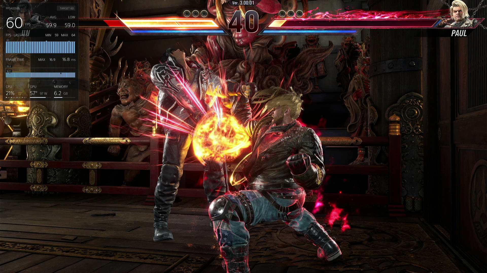
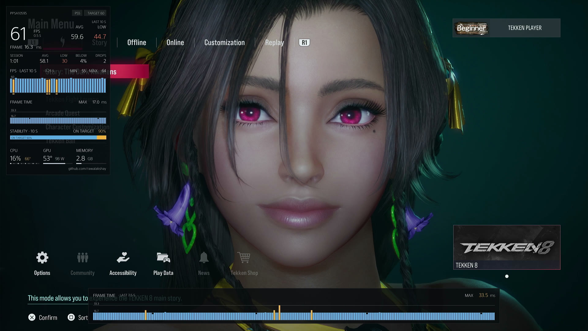
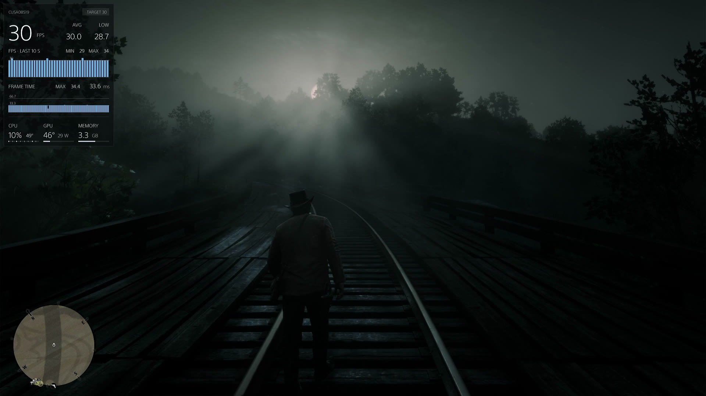
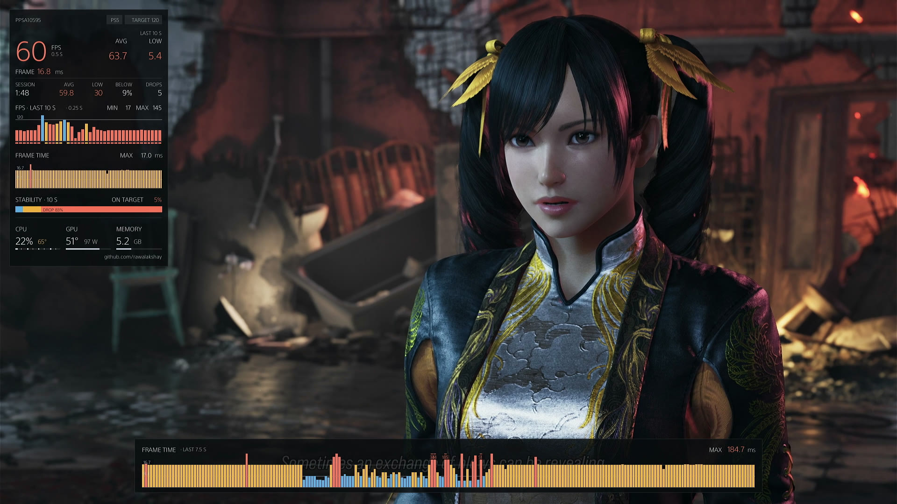
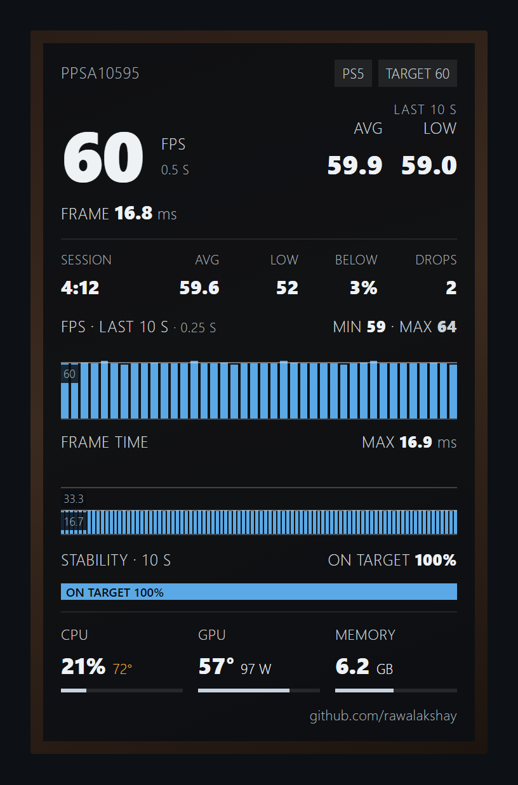
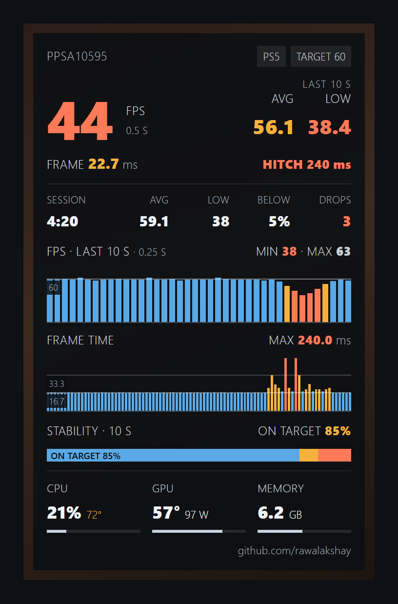
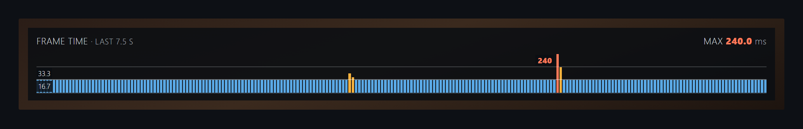
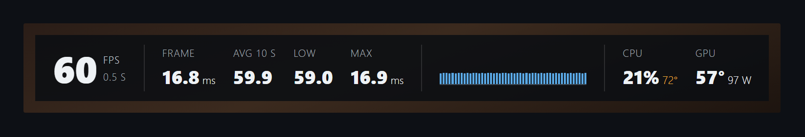
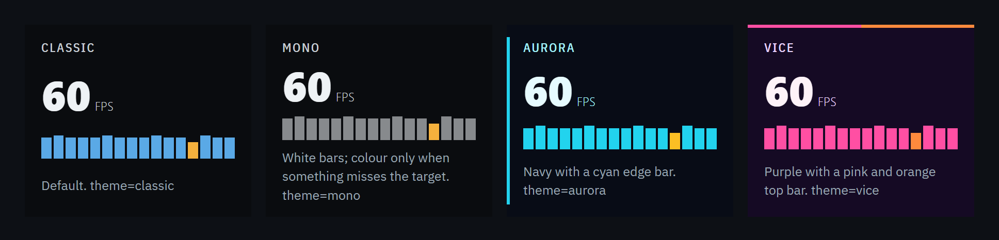

<h1 align="center">fps-monitor-panel</h1>

<p align="center">
  An in-game performance overlay for jailbroken PS5 consoles.<br>
  Frame rate, frame times, CPU / GPU temperatures and memory, drawn over any game from a single payload.
</p>

<p align="center">
  <a href="https://github.com/rawalakshay/fps-monitor-panel/releases/latest"></a>
  <a href="LICENSE"></a>
  
  <a href="https://github.com/rawalakshay/fps-monitor-panel/stargazers"></a>
</p>

<p align="center">
  <a href="#install">Install</a> ·
  <a href="#configuration">Configuration</a> ·
  <a href="#troubleshooting">Troubleshooting</a> ·
  <a href="#building-from-source">Build</a> ·
  <a href="#credits">Credits</a>
</p>



## Highlights

- **Live frame rate** with AVG and LOW over the last 10 s, and session totals since the game started.
- **Charts**: a 10 s FPS chart, a frame-time chart, a stability bar, and a 7.5 s frame-time graph along the bottom of the screen.
- **Hitch detection**: stalls longer than 100 ms are flagged in red with their length.
- **System stats**: CPU load and temperature, GPU temperature and power draw, memory in use.
- **PS5 and PS4 games**: PS4 titles running in backward compatibility are measured too.
- **Nothing injected into the game**: the overlay is drawn by the system UI.
- **Configurable**: four detail levels, four colour themes, position, size and opacity.
- **Survives rest mode**: the overlay reloads itself after resume.

## Screenshots

Captured on a PS5 with the default settings.

| Tekken 8 menu (PS5) | Red Dead Redemption 2 (PS4) | Tekken 8 cutscene (PS5) |
| :---: | :---: | :---: |
|  |  |  |
| Short drops show as amber bars | PS4 games, 30 FPS target detected | Stalls print their length in red |

## The overlay at a glance

Layout illustrations; the numbers are examples.

<div align="center">
<table>
  <tr>
    <th>Panel, on target</th>
    <th>Panel, during a drop</th>
  </tr>
  <tr>
    <td></td>
    <td></td>
  </tr>
</table>
</div>

**Frame-time graph** (on by default): 7.5 s of frame times centred along the bottom edge.



**Compact strip** (`detail=compact`): the key numbers in one row.



**Themes** (`theme=`): classic, mono, aurora and vice.



### Reading the panel

| Label | Meaning |
| --- | --- |
| **FPS** | Frame rate over the last 0.5 s. White on target, amber below 95 % of it, red below 80 %. |
| **AVG / LOW** | Average frame rate and the rate of the slowest 1 % of frames, over the last 10 s. |
| **TARGET** | The frame-rate cap the game appears to run at (30, 40, 60 or 120), detected automatically. |
| **FRAME** | Current frame time. A red **HITCH** badge shows the length of any stall longer than 100 ms in the last second. |
| **SESSION** | Time since the game started, with its average, low, share of time below target, and number of drops. |
| **STABILITY** | The last 10 s split into on target, slow (80–95 %) and dropped (below 80 %). |

## Install

**Requirements:** a jailbroken PS5 that runs payloads through an ELF loader, and a way to send an ELF to it over the network (for example `nc` or any payload sender).

1. Download the latest `fps-monitor` ELF from [Releases](https://github.com/rawalakshay/fps-monitor-panel/releases/latest).
2. Send it to the console's ELF loader. A `[FPS Monitor] started` notification confirms it is running.
3. Start a game. The panel appears in the top-left corner.

> [!NOTE]
> The payload runs until the console is turned off. It reloads the overlay by itself after rest mode; after a full reboot, send it again. Sending it twice shows `[FPS Monitor] already running`.

> [!WARNING]
> Do not run it alongside another performance overlay, such as the monitor bar of a full homebrew toolkit. It cannot detect other overlays, and both would draw at once.

## Configuration

Configuration is optional. Without a config file, every setting uses its default. The payload never creates or changes the file.

1. Copy [`config.ini.example`](config.ini.example) to `/data/fps-monitor/config.ini` on the console. The folder is created on first run.
2. Keep the `[meta]` section: a file without `schema_version=1` is ignored.
3. Edit the `[overlay]` keys.

The file is read when the overlay loads, so reboot and send the payload again after editing. Invalid values fall back to the default.

| Key | Values | Default | Effect |
| --- | --- | --- | --- |
| `detail` | `minimal`, `compact`, `panel`, `full` | `panel` | `minimal` is an FPS pill, `compact` a single strip, `panel` the full corner panel. `full` is currently the same as `panel`. |
| `theme` | `classic`, `mono`, `aurora`, `vice` | `classic` | Colour palette. |
| `edge` | `top`, `bottom` | `top` | Screen edge the overlay sits on. |
| `align` | `left`, `center`, `right` | `left` | Position along that edge. |
| `font_size` | `small`, `medium`, `large` | `medium` | Text size; the whole overlay scales with it. |
| `opacity` | `0`, `40`, `65`, `85` | `85` | Background opacity in percent; `0` hides the background. |
| `margin` | `0`, `5`, `10`, `20` | `20` | Gap from the screen edges, in pixels. |
| `system` | `true`, `false` | `true` | CPU / GPU / memory row. |
| `frame_graph` | `true`, `false` | `true` | 7.5 s frame-time graph along the bottom edge (top edge when `edge=bottom`). |
| `frame_graph_opacity` | `0`, `40`, `65`, `85` | `85` | Background opacity of the frame-time graph. |
| `fps_pill` | `true`, `false` | `false` | Also show a small FPS pill in the opposite corner. |
| `brand` | `true`, `false` | `false` | Show a "4aLse Benchmarks" header on the panel. |

Example:

```ini
[meta]
schema_version=1

[overlay]
detail=compact
edge=bottom
align=right
theme=aurora
frame_graph=false
```

## Troubleshooting

The log is at `/data/fps-monitor/fps-monitor.log`.

| Notification | Meaning |
| --- | --- |
| `[FPS Monitor] started` | The payload is running and will load the overlay. |
| `[FPS Monitor] already running` | A copy is already running; the new one exited. |
| `[FPS Monitor] overlay failed to load` | The overlay could not be loaded into the system UI. The payload tries 3 times, then waits for the system UI to restart (reboot, or rest mode and back). Check the log. |

- **"NO GAME DETECTED"**: no frames are being measured. This is normal in menus and loading screens.
- **Settings are ignored**: check the path, the `[meta]` section and the values against the table above, then reboot and send the payload again.
- **Two overlays on screen**: another performance overlay is running. Use only one.

## How it works

- **PS5 games**: the payload reads the display scanout counters (`/dev/dce`) and the frame counters of the game's own graphics driver (`libSceAgcDriver.sprx`) from outside the game process.
- **PS4 games**: it places a small remote hook on the game's GNM submit-and-flip call to count presented frames.
- **Drawing**: a module loaded into SceShellUI (the system UI) draws the overlay with the system's own UI widgets. Nothing is loaded into the game.

## Building from source

Requirements: Linux or WSL, the [PS5 Payload SDK](https://github.com/ps5-payload-dev/sdk) (a full release that includes `target/lib/libc++.a`), `cmake`, `ninja` and `python3`.

```sh
export PS5_PAYLOAD_SDK=/opt/ps5-payload-sdk
./scripts/build.sh          # --debug, --release, --jobs N, --build-dir DIR
```

The output is `build/bin/fps-monitor.elf`, the only file to send. The system UI module is built first and embedded in it.

Layout tests run on the host, without a console:

```sh
./scripts/test.sh           # add --render to write PNG previews
```

<details>
<summary>Project layout</summary>

| Path | Contents |
| --- | --- |
| `source/fps_monitor/source/` | Host payload: FPS sampler threads and the system UI injector / watchdog. |
| `source/fps_monitor/shellui/` | Overlay module entry point and `monitor_overlay.cpp` (sampling, render loop). |
| `source/shellui/` | UI helpers, scene layout (`overlay_scene.hpp`) and renderer. |
| `source/daemon/` | FPS sampler (`daemon_fps.cpp`): scanout, AGC counters, PS4 GNM hook. |
| `source/libonion_*`, `libhijacker`, `libNineS` | Vendored support libraries: process access, injection, settings, logging, notifications. |
| `source/i18n/` | Notification strings. |
| `source/platform/ps5/stubs/` | PS5 system library link stubs. |
| `tests/host/` | Host-side layout tests and renders. |
| `third_party/` | cJSON, SHA-1. |
| `docs/` | README screenshots and illustrations. |

</details>

## Credits

- Based on **HyperHEN** by **LightningMods**: the overlay, FPS sampler and support libraries come from it.
- Overlay design from **onionHEN 0.9.0** by **LightningMods**.
- FPS sampling approach follows **PHU Games Tools** by [ArkSama](https://github.com/ArkSama).
- ELF loading and ptrace helpers by **John Törnblom** (GPL-3.0-or-later).
- **cJSON** by Dave Gamble and contributors (MIT), **SHA-1 in C** by Steve Reid (public domain), **inih** by Ben Hoyt (BSD-3-Clause), **Hacker Disassembler Engine 64** by Vyacheslav Patkov.

Full notices are in [`THIRD_PARTY_NOTICES.md`](THIRD_PARTY_NOTICES.md).

## License

GPL-3.0. See [`LICENSE`](LICENSE). Third-party components keep their own terms.

<p align="center">
  If fps-monitor-panel is useful to you, a ⭐ on the repo helps others find it.
</p>
